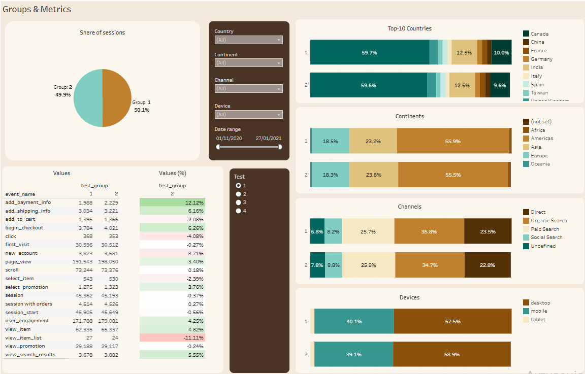
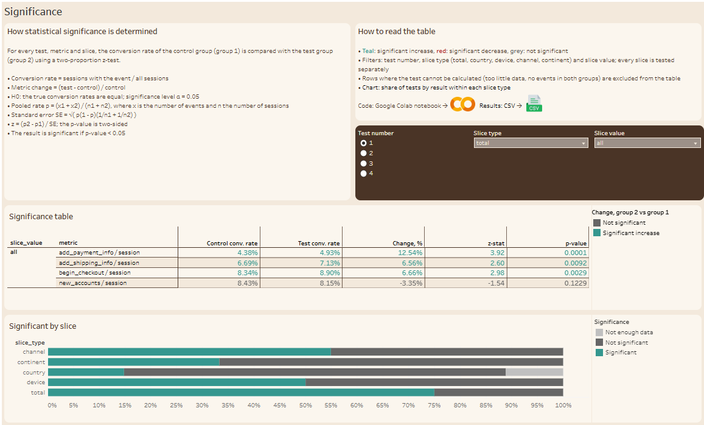

# Tableau Dashboard

Interactive two-page dashboard in Tableau Public.

**Live dashboard:** [A/B Testing: Statistical Significance](https://public.tableau.com/shared/H93M4WXHK)

## Page 1. Groups & Metrics
Share of sessions by test group, group composition by country (top 10), continent, channel and device, and event counts in both groups with the difference between them. Filters: test number, country, continent, channel, device, date range.

## Page 2. Significance
Significance table for the selected test: conversion rates of both groups, metric change, z-statistic and p-value, coloured by result (teal: significant increase, red: significant decrease, grey: not significant). A chart shows the share of significant results within each slice type. Filters: test number, slice type and slice value. The block on the page explains how significance is calculated and links to the notebook and the results CSV.

