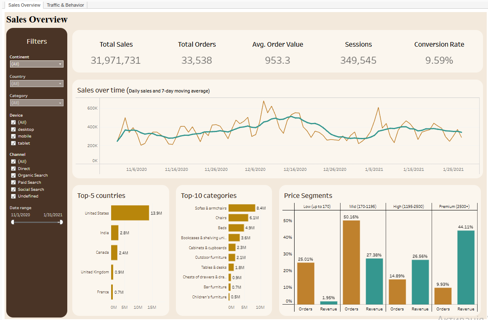
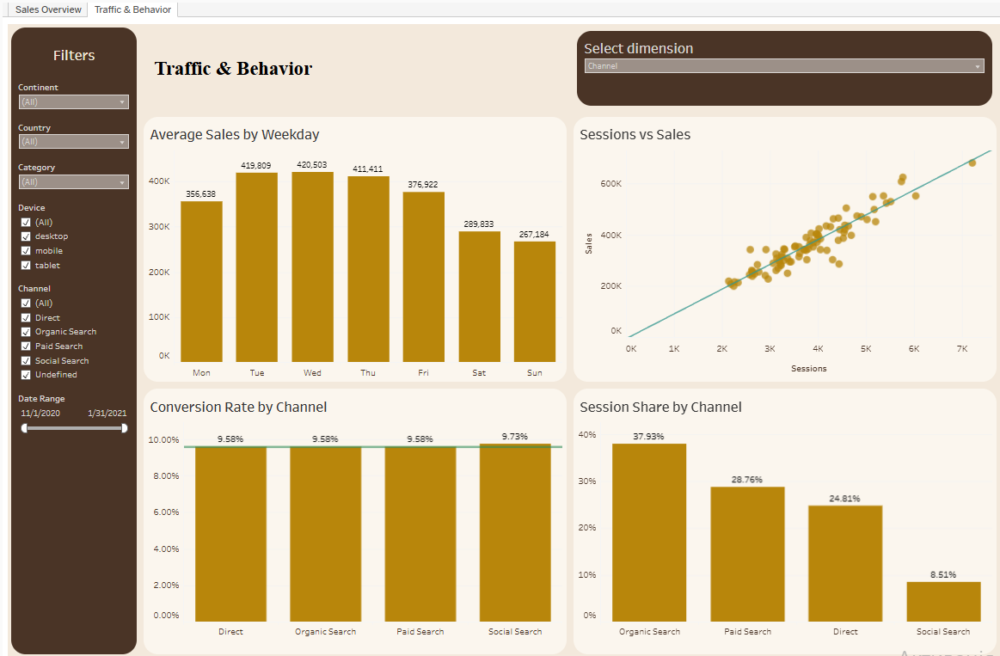

# Tableau Dashboard

Interactive two-page dashboard built in Tableau Public.

**Live dashboard:** [Ecommerce Sales Dashboard](https://public.tableau.com/views/EcommerceSalesDashboard_17930470371160/SalesOverview?:language=en-GB&:sid=&:redirect=auth&:display_count=n&:origin=viz_share_link)

## Page 1. Sales Overview
Key metrics (total sales, orders, average order value, sessions, conversion rate), sales over time with a 7-day moving average, top-5 countries, top-10 categories and price segments (share of orders vs share of revenue).

## Page 2. Traffic & Behavior
Average daily sales by weekday, relationship between sessions and sales, conversion rate and session share by channel, device or country (switchable with a parameter).

## Filters
Continent, country, category, device, traffic channel and date range apply across the sheets.

## Data
Prepared in the Python notebook (see `../python`): 349,545 sessions, Nov 2020 - Jan 2021, 11 columns plus a `has_purchase` flag (1 if the session ended with a purchase).
